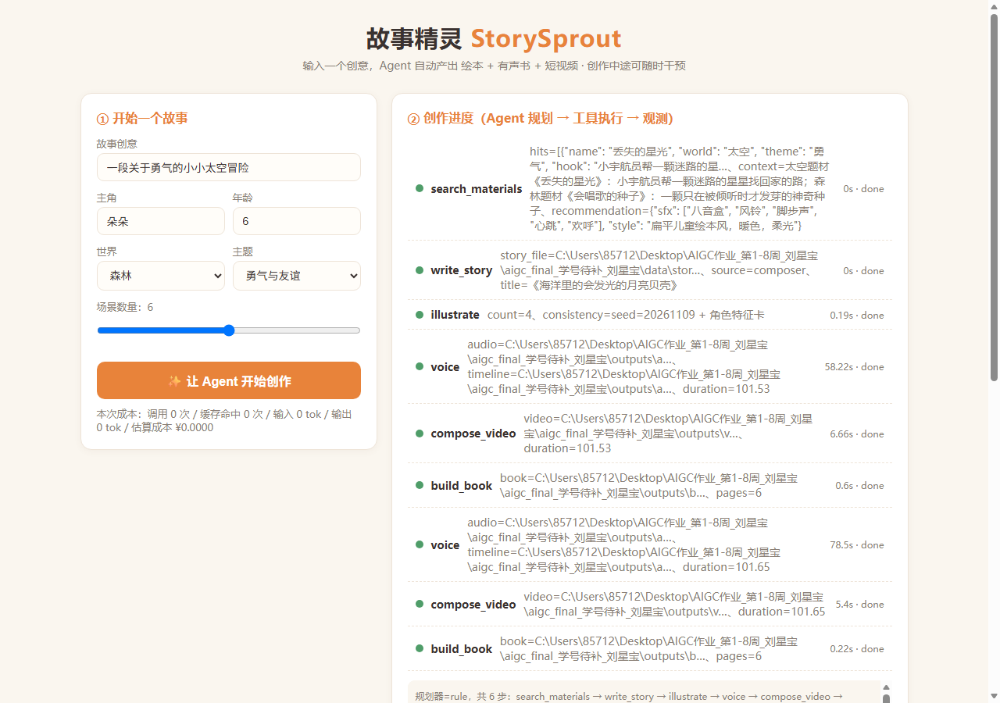
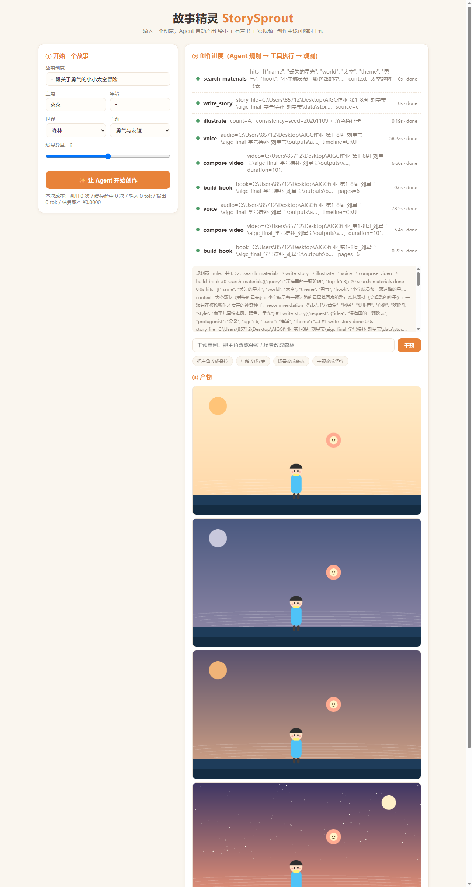

# 用户手册

> 第 14 周提交物 · `docs/user_manual.md` · 面向最终用户（家长 / 创作者）

## 1. 这个产品能帮你做什么

输入一句故事创意，"故事精灵"会自动为你产出一整套儿童故事产品：

- 📕 **绘本 PDF**（封面 + 逐幕图文 + 寓意页，可直接打印）
- 🎧 **有声书 MP3**（旁白和角色各有声音，带背景音乐）
- 🎬 **故事短片 MP4**（画面 + 配音 + 字幕）
- 📄 **故事文稿 JSON**（结构化，方便二次编辑）

主角就是你想的那个人——把孩子的名字写进去，孩子就是故事的主角。

## 2. 快速上手（3 步）

**第 1 步**：按部署指南启动后，打开 `http://127.0.0.1:8000`，你会看到：

**第 2 步**：在左侧填写：
- **故事创意**：一句话即可，比如"一颗迷路的星星想回家"；
- **主角**：孩子的小名和年龄；
- **世界**：太空 / 森林 / 海洋 / 城市 / 沙漠任选；
- **主题**与**场景数量**（4–8 幕，越多越慢）。

点 **"✨ 让 Agent 开始创作"**。右侧会实时显示 Agent 的每一步：检索素材 → 写故事 → 画配图 → 配音 → 剪短片 → 排绘本。整个过程约 1–3 分钟。

**第 3 步**：完成后，下方"③ 产物"区域会出现：
- 逐幕插画（往下滚动查看）；
- 音频播放器（戴上耳机，给宝宝听）；
- 视频播放器（画面带字幕）；
- "📕 绘本 PDF"链接（点开可保存/打印）。

## 3. 中途干预：对结果不满意？

在"干预"输入框里直接用大白话，例如：

| 你输入 | 系统做什么 |
| --- | --- |
| 把主角改成朵拉 | 全文改名 + 重配音频、重剪短片、重排绘本（**插画不重画**，又快又省） |
| 年龄改成 7 岁 | 重新创作故事并重做全部产物 |
| 场景改成森林 | 重新创作故事并重做全部产物 |
| 主题改成坚持 | 重新创作故事并重做全部产物 |

干预后新产物以"干预后"命名，原版本不会被覆盖，两版可以对比。

## 4. 功能一览

| 功能 | 怎么用 |
| --- | --- |
| 创作故事 | 表单 → "让 Agent 开始创作" |
| 观察进度 | 右侧步骤列表（绿=完成，黄=进行中）与事件流 |
| 查看成本 | 左侧"本次成本"实时显示（离线模式为 ¥0.0000） |
| 中途干预 | 干预框输入指令 → 点"干预"或点快捷按钮 |
| 听有声书 | 产物区音频播放器；MP3 文件在 `outputs/audio/` |
| 看短片 | 产物区视频播放器；MP4 文件在 `outputs/video/` |
| 打印绘本 | 点"📕 绘本 PDF"；PDF 文件在 `outputs/book/` |
| 导出创作日志 | `outputs/traces/log_web.md`（每步耗时与决策记录） |

## 5. 常见问题

**Q：生成的声音有时没人说话？**
A：语音合成需要联网。断网时系统会自动用"静音 + 字幕"继续工作，联网后重跑一次即可恢复。

**Q：同一个创意每次生成一样吗？**
A：离线模式下完全一样（确定性设计，方便对比与测试）；配置大模型密钥后，每次都会有新鲜感。

**Q：孩子名字里有生僻字？**
A：主角名支持 1–8 个字；生僻字可能影响语音发音，建议用常用小名。

**Q：能一次生成几个故事吗？**
A：界面一次跑一个（防止互相覆盖）；批量需求可用命令行：`python -m storysprout.cli "创意1" --tag c1` 后再跑下一个。
